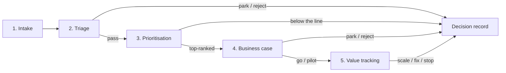

# Method: from AI idea to measured value

This kit runs every AI idea through the same five steps. Each step ends with an
explicit decision, so weak ideas are stopped early and cheaply, and the ideas
that go ahead carry their evidence with them.

> All names, figures and examples in this repository are **fictional**. They
> describe a made-up company, "Northwind Aero Services", and are not based on
> any real organisation.

| Step | Question it answers | Main output | Decision at the end |
|---|---|---|---|
| 1. Intake | Is this a real, measurable problem? | Completed intake form | Accept into triage, or return to the submitter |
| 2. Triage | Are there blockers, and what AI Act category applies? | Triage result, gate result | Pass, park or reject |
| 3. Prioritisation | Which cases are worth working on first? | Ranking, value-vs-feasibility matrix | Shortlist for a business case |
| 4. Business case | Does it pay back, and under which assumptions? | Business case, decision record | Go, pilot, park or reject |
| 5. Value tracking | Did it deliver what was planned? | Monthly value tracking, dashboard | Scale, fix or stop |

## Roles

The same roles appear in every step. One person can hold several roles in a
small organisation, but the process owner and the data owner must be named
people, not departments.

| Role | Responsibility in this method |
|---|---|
| **Portfolio lead** | Runs the method, keeps the use-case register, facilitates scoring, keeps decision records. |
| **Process owner** | Owns the business process and its KPIs. Provides volumes, times and error rates. Accountable for the benefit. |
| **Data owner** | Accountable for the data sources: access, quality, history, classification. |
| **IT / security** | Assesses integration, hosting, information security and data classification (including export control). |
| **Legal / compliance** | Confirms the AI Act classification and other legal duties (data protection, works council, export control). |
| **Finance / controlling** | Provides cost rates and the discount rate, checks benefit logic, validates realised value. |
| **Sponsor** | Owns the budget, takes the go/no-go decision, removes blockers. |

---

## Step 1: Intake

**Purpose:** capture each idea in a standard form, so that every idea is
described as a business problem with a measurable cost before anyone discusses
technology.

**Inputs**
- An idea from a business function, in any form (e-mail, workshop note, request).
- Rough figures on the current process: volumes, handling time, error rate.

**Outputs**
- A completed [`templates/intake_form.md`](templates/intake_form.md).
- A use-case ID (`UC-nn`) and one row in the use-case register
  (`examples/use_cases.csv` in this kit).

**Who is involved**
- Submitter and process owner: write the form.
- Data owner: fills in the data section.
- Portfolio lead: checks completeness and assigns the ID.

**Decision at the end:** *accept into triage* or *return to the submitter*. A
form is returned when the problem statement has no measurable cost, when no
process owner is named, or when the "does it decide about people" question is
unanswered.

**Typical failure modes**

| Failure mode | How it shows | Countermeasure |
|---|---|---|
| Solution looking for a problem | The form starts with "use generative AI to…" and the problem statement is vague. | Problem statement and its cost come first; the technique is the last field filled in. |
| Not an AI problem | The issue is a missing ERP field, a bad master-data rule or a missing report. | Ask "would a rule, a report or a configuration change fix this?" If yes, route it to the normal IT backlog. |
| Benefit not quantified | "Saves a lot of time." | Require a number and the assumption behind it, even if rough. Low confidence is acceptable; no number is not. |
| No owner | The process owner field says "Purchasing" instead of a person. | Return the form. Ownerless cases are parked at triage anyway. |
| Duplicates | Two functions submit the same idea with different names. | The portfolio lead checks the register for similar process names and techniques before assigning an ID. |

---

## Step 2: Triage

**Purpose:** find hard blockers before anyone spends time on scoring or a
business case, and give each case a first EU AI Act risk category.

**Inputs**
- The completed intake form.
- The triage checklist ([`triage/triage_checklist.yaml`](triage/triage_checklist.yaml))
  and the decision tree ([`triage/ai_act_triage.md`](triage/ai_act_triage.md)).

**Outputs**
- A screening AI Act category: prohibited, high-risk, limited risk
  (transparency), minimal risk, not an AI system, or excluded (used
  exclusively for military, defence or national security).
  `python -m scoring.triage examples/<ID>_<name>/triage.yaml` computes it
  from the checklist answers.
- A gate result: *pass*, *park* or *reject*, with the reason.
- The list of obligations and conditions to carry into the business case
  (for example, a transparency notice or an on-premise hosting requirement).

**Who is involved**
- Portfolio lead: runs the checklist with the process owner.
- Data owner and IT/security: confirm data availability, personal data, export
  control and hosting options.
- Legal/compliance: confirms any category other than "minimal risk", and any
  borderline case.

**Hard gates** (applied before scoring, whatever the expected value):

| Gate | Result |
|---|---|
| The screening category is "prohibited" | **Reject** |
| No data owner or no process owner | **Park** until both are assigned |
| Export-controlled or classified data, and only a public-cloud option exists | **Park** until an approved environment exists |

**Decision at the end:** *pass to prioritisation*, *park* (with the trigger that
reopens the case) or *reject* (with the reason). Parked and rejected cases get a
decision record.

**Typical failure modes**

| Failure mode | How it shows | Countermeasure |
|---|---|---|
| "Internal use, so the AI Act does not apply" | Triage skipped for internal tools. | Deployers have obligations too: AI literacy for all AI systems (Article 4) and specific duties for high-risk systems (Article 26) [1]. Run the checklist for every case. |
| Blanket defence exclusion | "We are a defence company, so we are out of scope." | The exclusion covers systems used *exclusively* for military, defence or national security purposes (Article 2(3)) [1]. It depends on the purpose of the system, not on the company: HR, finance or maintenance tools are civil uses. See the triage file. |
| Triage done once, never revisited | An internal assistant is later used to evaluate employees. | Re-run triage whenever the purpose, the users or the affected people change. |
| Export control found late | The data classification is discovered during the build. | Ask the export-control question at intake and confirm it with IT/security at triage. |
| Legal call made by the project team | A borderline case is self-classified as minimal risk. | The screening result is not legal advice. Borderline and non-minimal cases go to legal/compliance. |

---

## Step 3: Prioritisation

**Purpose:** rank the cases that passed triage, using the same weighted criteria
for all of them, so the shortlist can be explained and challenged.

**Inputs**
- The cases with gate result *pass*.
- The criteria and weights in [`scoring/criteria.yaml`](scoring/criteria.yaml):
  business value, feasibility, data maturity, AI maturity, risk (inverted) and
  strategic fit, each scored from 1 to 5.

**Outputs**
- `outputs/ranking.csv` and `outputs/ranking.md`: the weighted score out of 100,
  the contribution of each criterion and a one-line rationale per case.
- A value-vs-feasibility matrix (quick wins, strategic bets, fill-ins, avoid).
- A sensitivity check: does the top 3 change if a weight moves by ±10 points?

**Who is involved**
- Portfolio lead: facilitates a scoring session.
- Process owner, data owner and IT: score their part of the criteria using the
  level descriptions.
- Sponsor: confirms the weights before scoring and the shortlist after.

**Decision at the end:** the shortlist of cases that get a business case,
usually the top-ranked cases that fit the available capacity.

**Typical failure modes**

| Failure mode | How it shows | Countermeasure |
|---|---|---|
| Submitter scores their own idea | Every case scores 4 or 5 on value. | Score in a group, use the level descriptions, and record the reason for each score. |
| Weights tuned to reach a wanted answer | Weights change after the ranking is seen. | Fix the weights with the sponsor before scoring. Use `--weights` only for an explicit what-if. |
| False precision | 62.4 vs. 61.8 is read as a real difference. | Read the ranking in bands and check the sensitivity output. Close scores are a tie. |
| Value counted twice | The same benefit drives "business value" and "strategic fit". | Strategic fit scores the link to a stated goal, not the size of the benefit. |

---

## Step 4: Business case

**Purpose:** show what a shortlisted case costs, what it returns, when it pays
back, and which assumptions the answer depends on.

**Inputs**
- Volumes, handling times and error rates from the intake form, confirmed by the
  process owner.
- Build, licence and run costs from IT or a vendor.
- Cost rates and the discount rate from finance/controlling.
- Obligations and conditions from triage (they often add cost: human review,
  logging, a transparency notice, an on-premise model).

**Outputs**
- A completed [`templates/business_case.xlsx`](templates/business_case.xlsx) and
  its summary [`templates/business_case.md`](templates/business_case.md):
  annual benefit, one-off cost, run cost, payback, 3-year NPV, simple ROI, and
  pessimistic / base / optimistic scenarios.
  `python -m scoring.business_case <inputs.yaml> --xlsx <file> --md <file>`
  builds both from one inputs file.
- An assumptions log with a source and a confidence level for every input.
- A [`templates/decision_record.md`](templates/decision_record.md).

**Who is involved**
- Process owner: owns the benefit assumptions.
- IT / vendor: owns the cost assumptions.
- Finance/controlling: checks the benefit logic and the rates.
- Sponsor: takes the decision.

**Decision at the end:** *go* (build and deploy), *go with conditions*,
*pilot* (time-boxed, limited scope, with success and stop criteria), *park* or
*reject*. The decision, its conditions and its review date go into the
decision record.

**Downside rule.** If the 3-year NPV is negative in any scenario, a plain *go*
is not allowed. The case is approved only with conditions (*go with
conditions* or *pilot*): a review gate 3 months after go-live or pilot start,
and stop or rework if adoption or time saved fall to their pessimistic values.
The decision record shows the pessimistic NPV. If the base case is negative,
the case is reworked, parked or rejected. `python -m scoring.build_examples`
applies this rule to every example and refuses a record that breaks it.

**At the review gate.** Measure each trigger, compare it with its pessimistic
threshold, and re-run the business case on the measured values. If a trigger
is reached, the decision is *rework* or *stop*. A rework is allowed only if
the re-run, with the expected effect and cost of the rework actions, has a
positive NPV; it gets named actions and a new gate within 3 months. If no
trigger is reached, the case continues. Gate outcomes are added to section 9
of the decision record (`gate_reviews` in `decision.yaml`), and the generator
refuses an outcome that breaks these rules. A *continue* sets the date of the
next review. A new decision on the case (for example pilot → go with
conditions) gets a new decision record, with its own gate if a scenario is
still negative. In `examples/`, UC-03 shows a gate firing, a rework and a
second decision record; UC-05 shows a pilot stopped at its gate.

**Typical failure modes**

| Failure mode | How it shows | Countermeasure |
|---|---|---|
| Benefit counted twice | The same saved hours appear in two cases, or as both hours and headcount. | One benefit, one case. Each benefit line names its mechanism (redeployed hours, avoided cost, avoided error). |
| Hours saved treated as cash | 2,000 hours × hourly rate is booked as savings. | Hours are cash only if they are redeployed to valued work or a cost is avoided. The template separates the two. |
| Run cost forgotten | Only the build cost is counted. | Include hosting, licences that scale with users, monitoring, retraining and support. |
| 100% adoption from day one | The benefit starts in full at go-live. | Use an adoption curve (for example 50% in months 1–3, 80% after). |
| Optimistic base case | The base case already assumes everything goes well. | Change only the three most uncertain inputs across scenarios, and decide on the pessimistic case too. |
| Pessimistic case ignored | A negative pessimistic NPV is noted, then forgotten. | Downside rule: approval only with a 3-month review gate and stop/rework triggers at the pessimistic values. |

---

## Step 5: Value tracking

**Purpose:** after go-live, compare planned and realised benefits every month,
and decide whether to scale, fix or stop.

**Inputs**
- The planned monthly benefit and adoption from the business case.
- A baseline measured **before** go-live (volumes, handling time, error rate).
- Monthly actuals: realised benefit, adoption rate, incidents, notes.

**Outputs**
- Monthly rows in `data/value_tracking.csv`, starting in the go-live (or
  pilot start) month. Keep the original plan in `planned_benefit_eur`, even
  after a rework, so the gap stays visible.
- Charts (`python dashboard/charts.py`, written to `outputs/`): portfolio
  overview, cumulative planned vs. realised value with the review gates, and
  adoption against plan. The Power BI design for a management dashboard is in
  [`dashboard/README.md`](dashboard/README.md).
- A review decision, recorded in section 9 of the decision record with the
  date of the next review (`review_log` in `decision.yaml`). No review may be
  skipped: `python -m scoring.build_examples` checks that every review due by
  the portfolio's as-of date (`examples/portfolio.yaml`) is recorded, and that
  value tracking runs to that date.

**Who is involved**
- Process owner: reports the actuals and explains gaps.
- Finance/controlling: validates the realised benefit.
- Portfolio lead: consolidates the portfolio view.
- Sponsor: takes the scale / fix / stop decision at each review.

**Decision at the end of each review:** *continue*, *scale* (extend to more
sites, users or document types), *fix* (named actions and a new review date)
or *stop*. A parked case gets a *park review* against its reopening trigger:
*remain parked* or *reopen* (a new intake). In the examples, value reviews
take place every 6 months.

Suggested review rule, to adjust to your context: after six months, if realised
value is below 50% of plan and there is no credible fix, stop; if it is above
80% of plan and incidents are stable, consider scaling.

**Typical failure modes**

| Failure mode | How it shows | Countermeasure |
|---|---|---|
| No baseline | Nobody can say what the process cost before go-live. | Measure the baseline during the pilot preparation, not after. |
| Activity measured instead of value | "3,000 queries per month" is reported as success. | Track the benefit mechanism from the business case: hours redeployed, errors avoided, cost avoided. |
| Attribution | Another improvement project changes the same KPI. | Note other changes in the `notes` column and agree the attribution with controlling. |
| Sunk-cost reasoning | A failing case continues because money has been spent. | Use the review rule above and decide on future cost and benefit only. |
| Silent degradation | Accuracy drops as suppliers or document formats change. | Track incidents and a quality sample every month, not only adoption. |

---

## Measuring realised value in practice

The value tracking in step 5 is only as credible as the measurement behind
`realised_benefit_eur`. Four practices make the difference between a number a
controller signs and a number nobody trusts.

**1. Measure the baseline before go-live.** Measure the same quantities that
the business case uses (volume, handling time, error rate, cost per error)
before the solution is switched on, for 4 to 8 weeks of normal activity, and
with the method you will use afterwards. Record the baseline, its period and
its method in the assumptions log, then freeze it. A baseline rebuilt from
memory after go-live tends to make the old process look worse than it was.
If the process is seasonal, measure in a comparable period or note the gap.

**2. Sample time; do not estimate it.** "It saves about 5 minutes" is an
opinion. Use one of these instead, and use the same one before and after:
- a **time study** on a random sample of transactions (for example 30 to 50
  per period, spread over days and people), timed from start to end;
- **system timestamps** (opened → closed) where they reflect real work and
  not waiting time;
- **work sampling**: at random moments, record what people are doing, and
  derive the share of time spent on the task.

Report the median and the spread, not only the average, and the sample size.
Measure quality the same way: a blind audit of a sample (for example 300
records) against the same rules as the baseline.

**3. Compare with a group or a period without the AI.** A before/after
comparison also captures everything else that changed. Where possible, keep a
comparison group: a team, site or document type that does not use the
solution yet. A staggered roll-out gives one for free. The gain is then the
change in the AI group minus the change in the comparison group over the same
period (a difference-in-differences). Check that both groups moved in the same
way before go-live; if they did not, the comparison is weak, and you say so.
Without a comparison group, at least compare with the same months of the
previous year.

**4. Attribute gains when other changes happen at the same time.** A new ERP
release, a reorganisation, a volume drop or another improvement project can
move the same KPI.
- Log every such change in the `notes` column, with its date.
- Agree the attribution rule with controlling **before go-live**, not when the
  numbers come in: for example, "the comparison group absorbs common effects",
  or "a fixed share of the combined gain, agreed with the other project owner".
- If the effects cannot be separated, report the combined gain once and say
  which projects share it. Never count it in full in two business cases (see
  "Benefit counted twice", step 4).
- Hours saved become money only with evidence of redeployment or an avoided
  cost: a backlog that shrinks, overtime or temporary staff no longer paid, an
  external cost not incurred.

In the examples, the gate measurements follow these rules: UC-01 times 50
delivery notes, and UC-03 audits 300 work orders blind. The realised values
in `data/value_tracking.csv` are fictional. They are derived from the business
case model with the measured inputs, so they show the mechanics of tracking,
not the difficulty of measuring in a real organisation.

---

## Sources

[1] Regulation (EU) 2024/1689 (Artificial Intelligence Act), Official Journal of
the European Union, EUR-Lex: <https://eur-lex.europa.eu/eli/reg/2024/1689/oj>.
Detailed article references for the triage are in
[`triage/ai_act_triage.md`](triage/ai_act_triage.md).

This method is a structured screening and decision aid. It is not legal advice.
Any AI Act classification needs review by legal or compliance.
