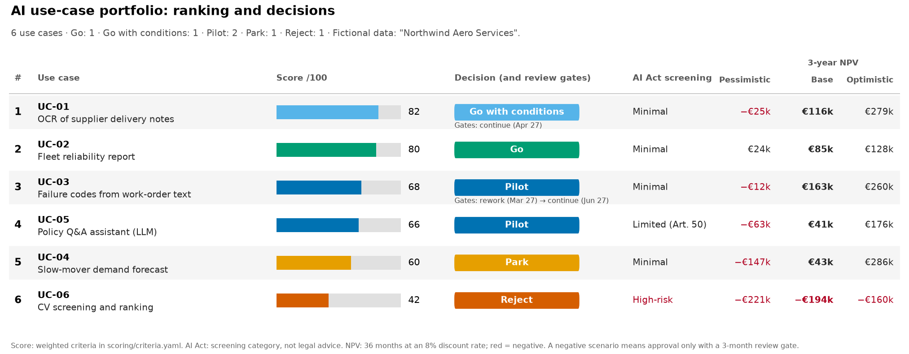
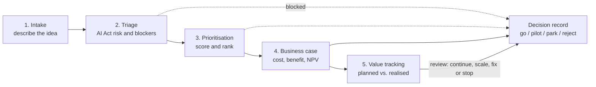
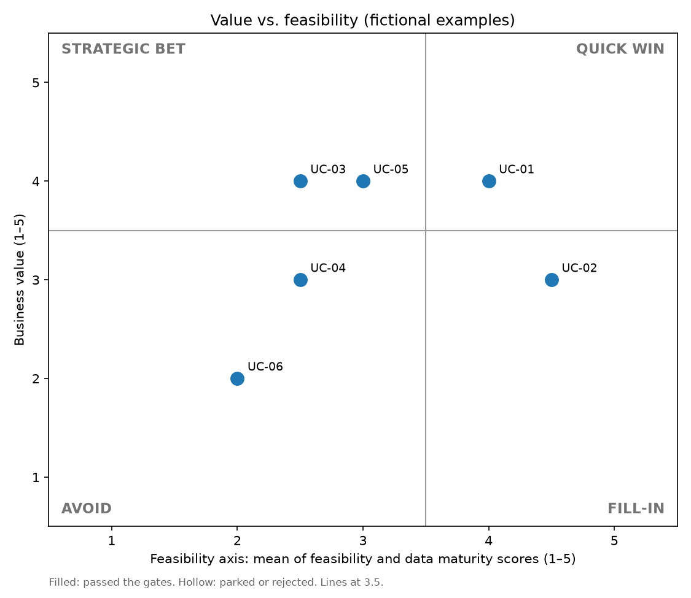
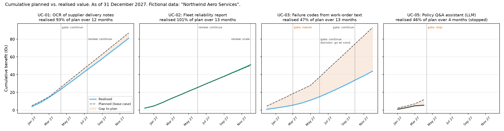

# AI Use-Case Pilot Kit



*The kit in one picture: six fictional use cases, scored, screened against the
EU AI Act, costed, decided and followed up, as of 31 December 2027.*

**What the kit does**

1. It turns AI ideas from business functions into comparable, one-page cases.
2. It ranks them on value, feasibility, data, AI maturity, risk and strategic fit, screens them against the EU AI Act, and costs the best ones.
3. It records each go / pilot / park / reject decision with its conditions, then tracks the value delivered and stops what does not work.

> **Read this first.** Everything in `examples/` and `data/` is **fictional**:
> "Northwind Aero Services" is an invented MRO and spare-parts company. The
> story is told **as of 31 December 2027**: every decision and review due by
> that date is recorded. The AI Act triage is a structured screening aid,
> **not legal advice**; final classification needs legal or compliance review.

## The 5-step method



| Step | Question it answers | What you get | Template |
|---|---|---|---|
| 1. Intake | What is the problem, how often, and what does it cost today? | A one-page form, the same for every idea | [`intake_form.md`](templates/intake_form.md) |
| 2. Triage | Is it allowed, how risky is it under the EU AI Act, and is anything blocking it (no data, no owner)? | A risk category with article references, and a pass, park or reject | [`ai_act_triage.md`](triage/ai_act_triage.md) |
| 3. Prioritisation | Which ideas are worth doing first? | A score out of 100 and a ranking, from six weighted criteria | [`criteria.yaml`](scoring/criteria.yaml) |
| 4. Business case | Does it pay back, and what if things go worse than planned? | Payback, 3-year NPV and ROI in three scenarios, in Excel with live formulas | [`business_case.md`](templates/business_case.md), [`.xlsx`](templates/business_case.xlsx) |
| 5. Value tracking | After go-live, is it delivering what was promised? | Monthly planned vs. realised value, and a review decision: continue, scale, fix or stop | [`value_tracking.csv`](data/value_tracking.csv) |

Each decision is written in a one-page [decision record](templates/decision_record.md).
One rule runs through the kit: **if any scenario loses money, the case is approved
only with a review gate 3 months after start**, and it is stopped or reworked if
adoption or time saved fall to the pessimistic values. The full method, with the
roles involved and the typical failure modes of each step, is in [`METHOD.md`](METHOD.md).

## Why I built this

I work as a Business Analyst in aerospace, where I also coordinate my site's digital roadmap. Since generative AI arrived, AI ideas keep coming: read this document automatically, write that report, answer these questions. Finding ideas was never the hard part. Deciding which ones deserve time and money, which ones the EU AI Act constrains, and whether they actually paid off after go-live was.

Automation projects taught me that a gain promised in a business case is not always a gain delivered. So I built the toolkit I wished I had: one intake form, one scoring grid, one AI Act check, one business case and one way to track value after go-live, applied end to end to six fictional use cases.

It is a starting point, not a standard. The weights, thresholds and examples are meant to be challenged.

## What happened to the six cases (as of 31 December 2027)

| Case | First decision | What happened next | Status |
|---|---|---|---|
| UC-01 OCR of supplier delivery notes | Go with conditions (a scenario is negative) | Gate passed in April 2027; value review in July: 91% of plan. 93% of plan over 12 months. | Live, next review January 2028 |
| UC-02 Fleet reliability report | Go | On plan (101%) for 13 months. December review: scale to the component shop. | Live, scaling in 2028 |
| UC-03 Failure codes from work-order text | Pilot | Pilot gate fired in March 2027 (15% wrong codes): rework. Passed in June; **new decision: go with conditions**. Roll-out gate passed in October, but only 47% of plan so far. | Live, under-delivering; the January 2028 review applies the 50% rule |
| UC-04 Slow-mover demand forecast | Park (data history too short) | Park review in September 2027: still only 18 months of clean data. | Parked, next check March 2028 |
| UC-05 Policy Q&A assistant (LLM) | Pilot, on-premise only | **Stopped** at its gate in April 2027: only 30% of questions went through the assistant. | Stopped |
| UC-06 CV screening and ranking | Reject (high-risk under the AI Act, negative NPV) | — | Rejected |

## Worked example: UC-05, from idea to stop

UC-05 shows the whole method on one case, including the part most portfolios
skip: stopping a pilot early.

1. **Intake** ([`intake.md`](examples/UC-05_policy_assistant/intake.md)). Staff ask about
   2,000 policy questions a month and spend about 15 minutes on each. Idea: an
   assistant that answers from the approved procedures and cites them. Some
   procedures cover export control, so the data must stay on-premise.
2. **Triage** ([`triage.md`](examples/UC-05_policy_assistant/triage.md)). Not prohibited,
   not high-risk: **limited risk**, with transparency duties (Article 50: people
   must be told they are interacting with an AI system). The export-control data
   passes the hard gate only because an approved on-premise environment exists.
3. **Prioritisation** ([`ranking.md`](outputs/ranking.md)). Score 66 out of 100,
   rank 4 of 6: high value on paper, but average feasibility and data
   readiness. In the value-feasibility matrix it is a "strategic bet".

   

4. **Business case** ([`business_case.md`](examples/UC-05_policy_assistant/business_case.md)).
   Base case: 3-year NPV €41k, payback in 18 months. Pessimistic case: −€63k.
   The saved minutes are spread across 600 people, so only the hours that are
   really redeployed count as money; the other €126k a year of "time saved" is
   shown but not counted.
5. **Decision** ([`decision_record.md`](examples/UC-05_policy_assistant/decision_record.md)).
   Because the pessimistic case loses money: **pilot** only, 100 users,
   on-premise, with a review gate on 11 April 2027. Stop or rework if time saved
   falls to 7 minutes or less per question, or adoption to 35% or less.
6. **Review gate, 11 April 2027.** Time saved was fine (8 minutes), but only
   30% of the pilot group's questions went through the assistant. The business
   case re-run on the measured values: −€66k. Decision: **stop**. The cleaned
   policy library and the test questions are kept for a later attempt.
7. **Value tracking** ([`value_tracking.csv`](data/value_tracking.csv)). Four
   months of data, 46% of plan, then nothing: the stop limited the loss to the
   pilot instead of three years of running costs.



## Limitations

- **The weights are a starting point.** They encode one set of priorities.
  Run `--sensitivity` to see whether the top 3 holds, and agree the weights
  with the portfolio board before scoring.
- **The triage is not legal advice.** It screens and documents; legal or
  compliance confirms. Open points are listed under [Open questions](#open-questions).
- **The examples are fictional.** The numbers are round and plausible, not
  benchmarks.
- **The scores are only as good as the inputs.** A business case built on
  guessed volumes gives a precise-looking but wrong NPV. The assumptions log
  rates each input's confidence for this reason.
- **Realised value is hard to measure.** The fictional tracking data is
  derived from the business case model, so it hides the hardest part: a
  baseline taken before go-live, sampled times instead of estimates, a
  comparison group, and an agreed attribution rule. See
  [Measuring realised value in practice](METHOD.md#measuring-realised-value-in-practice).

---

## For technical readers

### Quickstart

Python 3.11 or later.

```bash
pip install -r requirements.txt
python -m scoring.score examples/use_cases.csv   # ranking and matrix in outputs/
python dashboard/charts.py                       # portfolio, value and adoption charts in outputs/
```

One command rebuilds **everything** from the hand-written inputs: triage
results, business cases, decision records, ranking, sensitivity check, the
decisions table and all charts. It also checks that the story has no gaps.

```bash
python -m scoring.build_examples           # rebuild
python -m scoring.build_examples --check   # fail if a committed file is out of date
python -m pytest -q                        # tests
```

Other entry points: `python -m scoring.score examples/use_cases.csv --weights business_value=40,...`
and `--sensitivity`; `python -m scoring.triage <triage.yaml>`;
`python -m scoring.business_case <inputs.yaml> --xlsx out.xlsx --md out.md`.
Each prints its options with `--help`.

### How the numbers are made

- **Score.** Six criteria scored 1 to 5, weighted 30/20/20/10/10/10.
  Weighted score = Σ weight × score / 5, out of 100. Each level of each scale
  has a one-sentence description in [`criteria.yaml`](scoring/criteria.yaml).
- **Hard gates, before scoring.** AI Act "prohibited" → reject. No data owner
  or no process owner → park. Export-controlled or classified data with only a
  public cloud option → park.
- **Matrix.** Value = business value score; feasibility = mean of feasibility
  and data maturity; both split at 3.5.
- **Sensitivity.** Each weight ±10 points, the others rescaled in proportion
  to keep a total of 100; reports whether the top 3 changes.
- **Triage.** [`triage_checklist.yaml`](triage/triage_checklist.yaml) holds the
  yes/no questions; [`triage.py`](scoring/triage.py) returns the category and
  feeds the hard gates. An unknown answer counts as the stricter one.
- **Business case.** [`business_case.py`](scoring/business_case.py) computes
  the model in Python and writes the same model to Excel with live formulas;
  a test compares the two cell by cell. Three scenarios change only the three
  most uncertain inputs. Hours saved count as money only when redeployed or
  when they avoid a cost.
- **Decisions and reviews.** Each case has hand-written YAML files
  (`decision.yaml`, then `decision_2.yaml` for a later decision); the generator
  writes the decision records and refuses a record that breaks a rule: a plain
  go with a negative scenario, a continue when a trigger is reached, a rework
  whose re-run NPV is negative, a review held on the wrong date, a missing
  review before the as-of date in [`portfolio.yaml`](examples/portfolio.yaml),
  or value tracking that does not run from start to the as-of (or stop) month.

### Repository map

```
ai-use-case-pilot-kit/
├── README.md                  this page
├── METHOD.md                  the 5-step method in detail
├── LICENSE                    MIT (code)
├── LICENSE-docs               CC BY 4.0 (docs and templates)
├── templates/                 intake form, business case (md + xlsx + inputs), decision record
├── triage/                    AI Act triage guide and machine-readable checklist
├── scoring/                   scoring, triage, business case, decision records, example builder
├── examples/                  6 fictional use cases: one folder each, use_cases.csv, portfolio.yaml
├── data/                      fictional monthly value tracking
├── dashboard/                 static charts (charts.py) and the Power BI design (README.md)
├── outputs/                   generated ranking, decisions table and charts
├── tests/                     pytest suite
└── .github/workflows/ci.yml   runs the tests and the --check build on push
```

Each example folder holds the intake form, triage answers and result, business
case inputs and result, and decision record(s). Files you edit by hand:
`intake.md`, `triage.yaml`, `business_case_inputs.yaml`, `decision*.yaml`.
Everything else is generated.

### Power BI

[`dashboard/README.md`](dashboard/README.md) describes a star schema
(`fact_value_tracking`, `dim_use_case`, `dim_date`), the DAX measures and three
report pages, built on `data/value_tracking.csv` and `outputs/decisions.csv`.
No `.pbix` file is included.

## Open questions

Points of the EU AI Act triage that could not be fully verified against
EUR-Lex or official Commission pages. Each one is marked **TO VERIFY** where
it appears in [`triage/ai_act_triage.md`](triage/ai_act_triage.md).

**Last checked: 2026-10-10**

| # | Open question | Where | Why it matters |
|---|---|---|---|
| 1 | Does a pilot that handles live operational work count as "putting into service" (Article 3(11)), so that the research and testing exclusion of Article 2(8) no longer applies? | Triage, step 2 | Decides whether a pilot already carries AI Act duties. |
| 2 | How broad is the "safety reasons" exception to the ban on inferring emotions in the workplace (Article 5(1)(f)), for example for operator fatigue detection? | Triage, step 3 | The difference between a prohibited practice and an allowed safety tool. |
| 3 | How far does Annex I, Section B, point 20 (Regulation (EU) 2018/1139) reach for manned aircraft products and parts, and which EASA acts will carry the AI Act requirements, and when? | Triage, step 4a | Sets the high-risk route for AI in aviation products. |
| 4 | Have the Commission's guidelines on high-risk classification (draft of 19 May 2026) been finalised, and how do they read the third-party conformity assessment condition of Article 6(1)(b)? | Triage, step 4a | A broad reading would bring more AI in regulated products into high-risk. |
| 5 | At what point does fine-tuning or modifying a general-purpose AI model make a company the provider of a general-purpose AI model (Chapter V)? | Triage, step 7 | Decides whether Article 53 duties apply to the company itself. |

## References

- Regulation (EU) 2024/1689 (Artificial Intelligence Act), EUR-Lex:
  <https://eur-lex.europa.eu/eli/reg/2024/1689/oj>
- Regulation (EU) 2026/1744 (AI "Digital Omnibus", amending the application
  dates), EUR-Lex: <https://eur-lex.europa.eu/eli/reg/2026/1744/oj>
- European Commission, AI Act policy page:
  <https://digital-strategy.ec.europa.eu/en/policies/regulatory-framework-ai>
- ISO/IEC 42001:2023, AI management systems: <https://www.iso.org/standard/42001>
- NIST AI Risk Management Framework (AI RMF 1.0):
  <https://doi.org/10.6028/NIST.AI.100-1>

The kit links its steps to ISO/IEC 42001 and the NIST AI RMF in
[`triage/ai_act_triage.md`](triage/ai_act_triage.md). Using it does not make an
organisation certified or compliant with either.

## Licences

- Code (`scoring/`, `dashboard/*.py`, `tests/`): [MIT](LICENSE).
- Documentation, templates and examples (Markdown, YAML, CSV, Excel and PNG
  files): [CC BY 4.0](LICENSE-docs).
