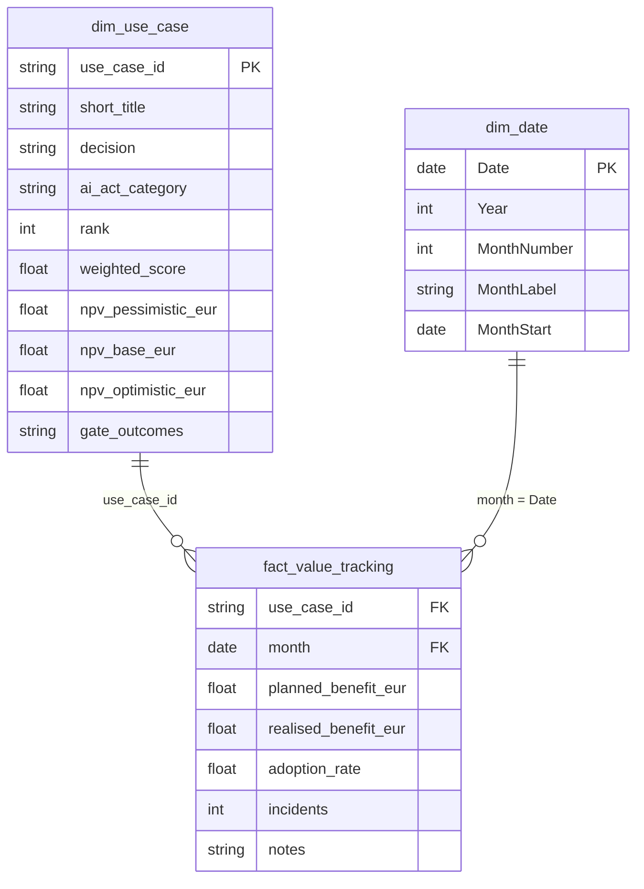

# Dashboard: Power BI design and static charts

> All data in this repository is **fictional** ("Northwind Aero Services").

Two ways to see the portfolio:

1. **Static charts, no Power BI needed:** `python dashboard/charts.py` writes
   three PNG files to `outputs/` (also run by `python -m scoring.build_examples`):
   - `portfolio_overview.png`: rank, score, decision, AI Act category, NPV
     range and review-gate outcomes per use case (the figure at the top of the
     main README);
   - `cumulative_value.png`: cumulative planned vs. realised value per tracked
     use case, with the review gates marked;
   - `adoption.png`: realised adoption against the business case plan.
2. **A Power BI report** for management, built from the same files. The design
   below is what to build; the `.pbix` file is not part of this repository.

---

## 1. Data model (star schema)



| Table | Source | Grain | Notes |
|---|---|---|---|
| `fact_value_tracking` | `data/value_tracking.csv` | one row per use case and month | `month` is the first day of the month. Amounts in euros per month, not cumulative. |
| `dim_use_case` | `outputs/decisions.csv` | one row per use case | Rename `id` to `use_case_id`. Also holds the cases without tracking data (park, reject, pilots not yet live), so the portfolio page shows all six. |
| `dim_date` | DAX calculated table | one row per day | Mark as date table. |

Relationships: `dim_use_case[use_case_id]` 1 → * `fact_value_tracking[use_case_id]`
and `dim_date[Date]` 1 → * `fact_value_tracking[month]`, both single
direction, filtering from the dimensions to the fact.

```dax
dim_date =
ADDCOLUMNS (
    CALENDAR ( DATE ( 2026, 1, 1 ), DATE ( 2028, 12, 31 ) ),
    "Year", YEAR ( [Date] ),
    "MonthNumber", MONTH ( [Date] ),
    "MonthLabel", FORMAT ( [Date], "MMM yy" ),
    "MonthStart", DATE ( YEAR ( [Date] ), MONTH ( [Date] ), 1 )
)
```

---

## 2. DAX measures

Put the measures in a dedicated `_Measures` table.

```dax
Planned value = SUM ( fact_value_tracking[planned_benefit_eur] )

Realised value = SUM ( fact_value_tracking[realised_benefit_eur] )

Value vs. plan % =
DIVIDE ( [Realised value], [Planned value] )

Value gap = [Realised value] - [Planned value]

Cumulative realised value =
VAR LastDate = MAX ( dim_date[Date] )
RETURN
    CALCULATE (
        [Realised value],
        REMOVEFILTERS ( dim_date ),
        dim_date[Date] <= LastDate
    )

Cumulative planned value =
VAR LastDate = MAX ( dim_date[Date] )
RETURN
    CALCULATE (
        [Planned value],
        REMOVEFILTERS ( dim_date ),
        dim_date[Date] <= LastDate
    )

Cumulative value vs. plan % =
DIVIDE ( [Cumulative realised value], [Cumulative planned value] )

-- Simple average over the months and use cases in the filter context.
-- Weight by volume if the use cases differ a lot in size.
Adoption rate = AVERAGE ( fact_value_tracking[adoption_rate] )

Incidents = SUM ( fact_value_tracking[incidents] )

Use cases = DISTINCTCOUNT ( dim_use_case[use_case_id] )

Base NPV of approved cases =
CALCULATE (
    SUM ( dim_use_case[npv_base_eur] ),
    dim_use_case[decision] IN { "go", "go_with_conditions", "pilot" }
)

Cases with a negative scenario =
CALCULATE ( [Use cases], dim_use_case[npv_pessimistic_eur] < 0 )
```

Conditional formatting rule used on every page: **Value vs. plan %** below 80%
amber, below 50% red (the review rule in `METHOD.md`, step 5).

---

## 3. Report pages

### Page 1: Portfolio overview

Question it answers: *what is in the portfolio, and what did we decide?*

| Visual | Fields |
|---|---|
| Cards | Use cases; Base NPV of approved cases; Cases with a negative scenario |
| Table, sorted by rank | rank, use_case_id, short_title, weighted_score (data bar), decision (colour by decision), ai_act_category, npv_pessimistic_eur / npv_base_eur / npv_optimistic_eur, gate_outcomes |
| Stacked bar | Use cases by decision (go, go with conditions, pilot, park, reject) |
| Scatter | Value vs. feasibility: import the scores from `outputs/ranking.csv` as an extra table, or show `outputs/value_feasibility_matrix.png` as an image |

Use the same decision colours as the static charts (`DECISION_COLOURS` in
`scoring/decision.py`).

### Page 2: Value delivered

Question it answers: *are the live cases delivering what the business case promised?*

| Visual | Fields |
|---|---|
| Line chart, small multiples by use case | dim_date[MonthStart]; Cumulative planned value (dashed) and Cumulative realised value |
| Cards | Realised value; Value vs. plan %; Value gap |
| Matrix | use_case_id × MonthLabel, values: Value vs. plan % with the conditional formatting rule |
| Slicer | decision, use_case_id |

Mark the review gates on the line chart with a constant line per gate date, or
add a small `gate_events` table (use_case_id, date, outcome) taken from
`gate_outcomes`.

### Page 3: Adoption and incidents

Question it answers: *is the solution used, and is it stable?*

| Visual | Fields |
|---|---|
| Line chart | MonthLabel; Adoption rate, legend use_case_id |
| Column chart | MonthLabel; Incidents, legend use_case_id |
| Table | use_case_id, month, adoption_rate, incidents, notes (the explanation of each gap) |

---

## 4. Refresh

1. Process owners add one row per use case per month to
   `data/value_tracking.csv`; controlling validates `realised_benefit_eur`.
2. `python -m scoring.build_examples` rebuilds the records, `decisions.csv`
   and the static charts.
3. Refresh the Power BI dataset.
