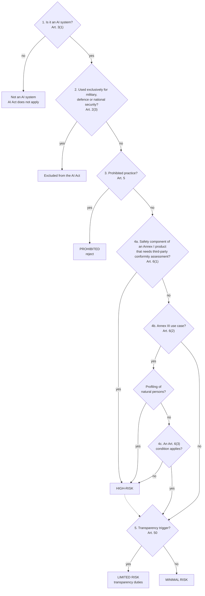

# EU AI Act triage

> **Dates:** all application dates in this file reflect the amendments made by Regulation (EU) 2026/1744 (Digital Omnibus on AI), in force since 27 July 2026.

A plain-English screening guide for AI use cases in an industrial company. It
gives each case a first risk category, which feeds the hard gates in
`scoring/score.py` and the risk criterion in `scoring/criteria.yaml`.

> **Disclaimer.** This is a structured screening aid, not legal advice. The
> final classification of any AI system needs review by legal or compliance.
> The examples are fictional.

**Legal text used:** Regulation (EU) 2024/1689 (the AI Act) [R1], as amended
by Regulation (EU) 2026/1744 (the "Digital Omnibus on AI") [R2], which entered
into force on 27 July 2026. Article numbers refer to the AI Act as amended.
Text checked on EUR-Lex on 10 October 2026. Points that could not be verified
are marked **TO VERIFY** and listed under
[Open questions in the README](../README.md#open-questions).

The machine-readable version of the questions is
[`triage_checklist.yaml`](triage_checklist.yaml); `python -m scoring.triage`
applies it to a use case.

---

## 1. Decision tree

Answer the questions in order. Stop at the first box that gives a category,
with one exception: run the transparency check (step 5) for high-risk systems
too, because the Article 50 duties come in addition to the high-risk
requirements (Article 50(6)) [R1].

---

## 2. The questions, branch by branch

### Step 1: Is it an AI system at all?

**Article 3(1)** defines an AI system as "a machine-based system that is
designed to operate with varying levels of autonomy and that may exhibit
adaptiveness after deployment, and that, for explicit or implicit objectives,
infers, from the input it receives, how to generate outputs such as
predictions, content, recommendations, or decisions that can influence
physical or virtual environments" [R1].

**In practice.** The key word is *infers*. Recital 12 says the definition
"should not cover systems that are based on the rules defined solely by
natural persons to automatically execute operations" [R1]. So a classic ERP
workflow, an Excel macro or an RPA bot that follows fixed rules is usually
not in scope. A machine-learning model, an OCR engine with a trained model, or
an LLM assistant usually is. The Commission has published guidelines on the
definition [C3]. Borderline cases (for example optimisation solvers or
statistical forecasting) go to legal review.

### Step 2: Exclusions (military, defence, national security)

**Article 2(3)**: the AI Act "does not apply to AI systems where and in so far
they are placed on the market, put into service, or used with or without
modification exclusively for military, defence or national security purposes,
regardless of the type of entity carrying out those activities" [R1].

**In practice.**
- The test is the **purpose of the system**, not the type of company. A
  defence company's HR, finance, procurement or maintenance-planning tools are
  civil uses and are in scope.
- The word **exclusively** matters. Recital 24 states that a system developed
  for military purposes that is used, temporarily or permanently, for civilian
  purposes falls within the scope of the AI Act [R1]. Dual-use systems are
  therefore in scope for their civil use.
- Export-control rules are separate from the AI Act. They are handled by the
  data gate in `scoring/score.py`, not by this triage.

Article 2 also excludes research and development before a system is placed on
the market or put into service (Article 2(6) and 2(8)); testing in real-world
conditions is not covered by that exclusion (Article 2(8)) [R1]. "Putting into
service" includes supply "for own use" (Article 3(11)) [R1]. A pilot that
handles live operational work is therefore likely to be in scope.
**TO VERIFY** with legal for each pilot design (open question 1).

### Step 3: Prohibited practices

**Article 5(1)** prohibits placing on the market, putting into service or
using AI systems for the following practices [R1, R2]:

| Point | Prohibited practice (summary) |
|---|---|
| (a) | Subliminal, manipulative or deceptive techniques that materially distort behaviour and cause significant harm. |
| (b) | Exploiting vulnerabilities due to age, disability or a specific social or economic situation, causing significant harm. |
| (ba) | Generating or manipulating realistic intimate or sexually explicit images, video or audio of an identifiable person without consent (added by [R2], applies from 2 December 2026). |
| (bb) | Generating child sexual abuse material (added by [R2], applies from 2 December 2026). |
| (c) | Social scoring leading to detrimental or unjustified treatment. |
| (d) | Predicting the risk that a person commits a criminal offence based solely on profiling or personality traits. |
| (e) | Building facial recognition databases by untargeted scraping of the internet or CCTV. |
| (f) | Inferring emotions of a person **in the workplace** or in education, except for medical or safety reasons. |
| (g) | Biometric categorisation to infer race, political opinions, trade union membership, religious or philosophical beliefs, sex life or sexual orientation. |
| (h) | Real-time remote biometric identification in publicly accessible spaces for law enforcement, except in narrowly defined cases. |

**In practice for an industrial company**, point (f) is the one most likely to
come up: for example, a camera system that reads employees' emotions or
stress levels on the shop floor. The "safety reasons" exception (for example,
fatigue detection for operators of dangerous machinery) is narrow.
**TO VERIFY** with legal for any such case, using the Commission guidelines
on prohibited practices [C4] (open question 2).

**Gate:** prohibited → **reject**, whatever the score.

### Step 4: High-risk

There are two routes to high-risk.

#### 4a. Article 6(1) and Annex I: safety components of regulated products

An AI system is high-risk when **both** conditions hold (Article 6(1)) [R1]:
1. it is a safety component of a product, or is itself a product, covered by
   the Union harmonisation legislation listed in Annex I; and
2. that product must undergo a third-party conformity assessment under that
   legislation.

Since 27 July 2026, Article 6(1a) states that AI systems "solely used for
non-safety related aspects of user assistance, performance optimisation,
service efficiency, automation or convenience or quality control shall not
qualify as safety components", unless their failure or malfunction would
endanger health and safety (Article 6(1b)) [R2]. The definition of "safety
component" in Article 3(14) was also reworded [R2].

**Annex I has two sections** [R1, R2]:
- **Section A** (New Legislative Framework acts, for example toys, lifts,
  radio equipment, pressure equipment, medical devices): the full high-risk
  regime applies. Point 1 (the old Machinery Directive) was deleted by [R2].
- **Section B** (other harmonisation acts, including civil aviation security
  (Regulation (EC) No 300/2008, point 13), vehicles, marine equipment, rail,
  Regulation (EU) 2018/1139 on civil aviation (point 20) and, since [R2], the
  Machinery Regulation (EU) 2023/1230 (point 21)): **reduced set of
  provisions**. Under Article 2(2), as amended, "only Article 6(1), Article
  60a and Articles 102 to 112 shall apply" [R2]. Articles 102 to 109 amend the
  sectoral acts so that the Commission must take the AI Act's high-risk
  requirements (Chapter III, Section 2) into account when it adopts delegated
  or implementing acts under them. For Regulation (EU) 2018/1139, see Article
  108 of the AI Act [R1] and Article 2 of [R2].

**Civil aviation.** Annex I, Section B, point 20 lists Regulation (EU)
2018/1139 "in so far as the design, production and placing on the market of
aircrafts referred to in Article 2(1), points (a) and (b) thereof, where it
concerns unmanned aircraft and their engines, propellers, parts and equipment
to control them remotely, are concerned" [R1]. What this means in practice:
- AI that is a safety component of an aviation product is regulated through
  the EASA framework. The AI Act requirements arrive through future EASA
  delegated or implementing acts, not through an AI Act conformity assessment
  run by the company.
- **TO VERIFY** (open question 3): how far the wording of point 20 reaches
  for manned aircraft products and parts, and which EASA acts will carry the
  requirements, and when.
- Business-support tools in an aerospace company (document capture,
  reporting, demand forecasting) are not safety components (Article 6(1a))
  [R2].
- AI that influences airworthiness decisions (for example, deciding that a
  part is serviceable) needs a separate review under the EASA framework. This
  kit scores it as safety-critical (risk level 1 in `criteria.yaml`),
  whatever its AI Act category.

The Commission published **draft** guidelines on high-risk classification on
19 May 2026, with practical examples for Annex I and Annex III [C5]. Summaries
by law firms report that the draft reads the third-party conformity assessment
condition broadly. **TO VERIFY** (open question 4): whether the guidelines have been finalised,
and their final position on that condition.

#### 4b. Article 6(2) and Annex III: listed use cases

Annex III lists eight areas [R1]. Those that matter most in industry are in
bold.

| Annex III point | Area | Industrial examples |
|---|---|---|
| **1** | Biometrics: remote biometric identification, biometric categorisation by sensitive attributes, emotion recognition | Face recognition at a distance on site. Biometric **verification** whose sole purpose is to confirm that a person is who they claim to be (for example, a badge-plus-fingerprint door) is excluded from point 1(a). |
| **2** | Critical infrastructure: safety components in the management and operation of critical digital infrastructure, road traffic, or the supply of water, gas, heating or electricity | AI controlling a site's own energy supply, if it counts as critical infrastructure. |
| 3 | Education and vocational training | Rarely relevant. Check it if the company runs a vocational training institution, such as an apprentice school, and the AI decides on access or assesses learning outcomes. |
| **4** | **Employment, workers' management and access to self-employment**: (a) recruitment and selection, including filtering applications and evaluating candidates; (b) decisions on terms of work, promotion or termination, task allocation based on behaviour or personal traits, monitoring and evaluating performance and behaviour | **CV screening and ranking, performance evaluation, shift allocation based on personal traits.** The most common high-risk area for a company that is not a provider of AI products. |
| **5** | Access to essential private and public services: (b) creditworthiness of natural persons (except fraud detection); (c) risk assessment and pricing in life and health insurance | Rare in industry, except company benefit schemes. |
| 6–8 | Law enforcement, migration and border control, administration of justice and democratic processes | Not relevant for most industrial companies. |

#### 4c. Article 6(3): exceptions for Annex III systems

An Annex III system is **not** high-risk when it "does not pose a significant
risk of harm to the health, safety or fundamental rights of natural persons,
including by not materially influencing the outcome of decision making", and
at least one of these conditions holds (Article 6(3)) [R1]:
- (a) it performs a narrow procedural task;
- (b) it improves the result of a previously completed human activity;
- (c) it detects decision-making patterns or deviations without replacing or
  influencing the completed human assessment without proper human review;
- (d) it performs a preparatory task to an assessment relevant to an Annex III
  use case.

Two limits:
- An Annex III system that performs **profiling** of natural persons is
  **always** high-risk (Article 6(3), last subparagraph) [R1].
- A provider that relies on the exception must **document** its assessment
  before putting the system into service and **register** it (Article 6(4),
  Article 49(2)) [R1].

**In practice:** a tool that only converts CVs into a standard format may fit
condition (a). A tool that ranks or scores applicants does not; ranking
candidates is evaluation and is likely to involve profiling.

### Step 5: Limited risk (transparency)

**Article 50** sets transparency duties for certain systems, whatever their
risk level [R1]:

| Paragraph | Who | Duty |
|---|---|---|
| 50(1) | Provider | Systems that interact directly with people (for example chatbots) must be designed so that people are told they are interacting with an AI system, unless this is obvious. |
| 50(2) | Provider | Synthetic audio, image, video or text output must be marked in a machine-readable format and be detectable as AI-generated (exceptions for assistive editing). |
| 50(3) | Deployer | People exposed to emotion recognition or biometric categorisation must be informed. |
| 50(4) | Deployer | Deep fakes must be disclosed. AI-generated text published to inform the public on matters of public interest must be disclosed, unless it has undergone human review or editorial control. |
| 50(5) | Both | The information is given clearly, at the latest at the first interaction or exposure. |

**In practice:** an internal policy Q&A assistant built on an LLM triggers
50(1). The company that builds it and puts it into service under its own name
for its own staff is the **provider** of that AI system (Article 3(3) and
3(11)) and also its deployer (Article 3(4)) [R1].

### Step 6: Minimal risk

No specific obligations under the AI Act. Two points still apply:
- **AI literacy (Article 4):** providers and deployers "shall take measures to
  support the development of AI literacy of their staff and other persons
  dealing with the operation and use of AI systems on their behalf". Since
  [R2], this "does not require providers or deployers to guarantee any
  specific level of AI literacy of any individual" (Article 4(1)) [R2].
- **Voluntary codes of conduct** (Article 95) [R1].

Other law still applies, in particular data protection (Article 2(7)) [R1,
R2].

### Step 7: General-purpose AI models (Chapter V)

A general-purpose AI model is a model that "displays significant generality
and is capable of competently performing a wide range of distinct tasks"
(Article 3(63)) [R1]; large language models are the usual example.

- **Obligations fall mainly on the model provider** (Article 53): technical
  documentation, information for downstream providers, a copyright policy and
  a public summary of training content. Models with systemic risk have extra
  duties (Article 55) [R1]. These obligations apply from 2 August 2025.
- **A company that only uses an LLM through an API** is not the provider of
  the model, so Chapter V does not apply to it. If it builds an AI system on
  top of the model, for example an internal assistant, it is the provider of
  that **AI system**. The system's own risk level then sets the obligations
  (for example Article 50(1) for a chatbot). The model provider must give it
  the information it needs (Article 53(1)(b)) [R1].
- **Change of purpose.** If the company uses a general-purpose system for a
  high-risk purpose, for example asking an LLM to rank job applicants, it
  becomes the provider of a high-risk AI system (Article 25(1)(c)) [R1].
- **TO VERIFY** (open question 5): at what point fine-tuning or modifying a model makes the
  company a provider of a general-purpose AI model. Check the Commission's
  guidance for general-purpose AI providers.

---

## 3. Obligations by risk level

Main obligations only. The deployer column is what an industrial company
using a system has to do. The provider column applies when the company builds
the system itself, including for its own use (Article 3(3) and 3(11)) [R1].

| Category | Deployer (company using the system) | Provider (company building the system) |
|---|---|---|
| **Prohibited** | Must not use it (Article 5). | Must not place it on the market or put it into service (Article 5). |
| **High-risk** | Article 26: use it according to the instructions for use (26(1)); assign human oversight to competent, trained people with authority (26(2)); ensure input data is relevant and representative where it controls it (26(4)); monitor operation, report risks and serious incidents, and suspend use if needed (26(5)); keep logs for at least six months (26(6)); inform workers' representatives and affected workers before workplace use (26(7)); use the provider's information for the data protection impact assessment (26(9)); inform people subject to decisions made with Annex III systems (26(11)). A fundamental rights impact assessment (Article 27) is required only for public bodies, private entities providing public services, and Annex III points 5(b) and 5(c). Affected people have a right to an explanation (Article 86). | Article 16 and Chapter III, Section 2: risk management (Article 9), data governance (10), technical documentation (11), record-keeping (12), information to deployers (13), human oversight by design (14), accuracy, robustness and cybersecurity (15), quality management system (17), conformity assessment (43), EU declaration of conformity and CE marking (47, 48), registration (49), post-market monitoring (72), serious incident reporting (73). |
| **Limited risk (transparency)** | Article 50(3) and 50(4) where relevant. AI literacy (Article 4). | Article 50(1) and 50(2) where relevant. AI literacy (Article 4). |
| **Minimal risk** | AI literacy (Article 4). Voluntary codes (Article 95). | AI literacy (Article 4). Voluntary codes (Article 95). |
| **General-purpose AI model** | No Chapter V duty; the duties of the AI system built on the model apply. | Model providers: Article 53; with systemic risk, also Article 55. |

Sources: [R1], as amended by [R2]. Obligations apply only from the dates in
section 4.

---

## 4. Application dates

The AI Act was published in the Official Journal on 12 July 2024 and entered
into force on the twentieth day after publication (Article 113) [R1]. The
dates below take into account the amendments made by Regulation (EU)
2026/1744 [R2].

| Date | What applies | Legal basis | Status |
|---|---|---|---|
| 1 August 2024 | Entry into force | Article 113, first paragraph [R1] | Unchanged |
| 2 February 2025 | Chapters I and II: general provisions including AI literacy (Article 4), and prohibited practices (Article 5) | Article 113(a) [R1] | Unchanged (Article 4 reworded by [R2]) |
| 2 August 2025 | Chapter III Section 4 (notified bodies), Chapter V (general-purpose AI models), Chapter VII (governance), Chapter XII (penalties) and Article 78, except Article 101 | Article 113(b) [R1] | Unchanged |
| 27 July 2026 | Regulation (EU) 2026/1744 enters into force; Articles 102 to 110 apply | Article 4 of [R2]; Article 113(d) as added by [R2] | New |
| 2 August 2026 | General date of application, including Article 50 (transparency) and Article 101 | Article 113, second paragraph [R1] | Unchanged |
| 2 December 2026 | New prohibitions in Article 5(1)(ba) and (bb); Article 50(2) for generative systems placed on the market before 2 August 2026 | Article 113(a) as amended, Article 111(4) as added [R2] | New |
| 2 August 2027 | General-purpose AI models placed on the market before 2 August 2025 must comply | Article 111(3) [R1] | Unchanged |
| 2 December 2027 | Chapter III, Sections 1 to 3 for **Annex III** high-risk systems (Article 6(2)), including deployer obligations in Article 26 | Article 113(c)(i) as amended [R2] | **Changed** (was 2 August 2026) |
| 2 August 2028 | Chapter III, Sections 1 to 3 for **Annex I** high-risk systems (Article 6(1)) | Article 113(c)(ii) as amended [R2] | **Changed** (was 2 August 2027) |
| 2 August 2030 | High-risk systems intended to be used by public authorities and already on the market must comply | Article 111(2) [R1, R2] | Unchanged |

**Amendment status.** The Digital Omnibus on AI was proposed by the Commission
on 19 November 2025, reached political agreement on 7 May 2026, was adopted as
Regulation (EU) 2026/1744 on 8 July 2026, published in the Official Journal on
24 July 2026, and entered into force on 27 July 2026 [R2, C1, C2]. Status:
**adopted and in force.**

Article 111(2), as amended, also says that high-risk systems placed on the
market or put into service before the relevant application date are covered
only if their design changes significantly after that date [R2].

---

## 5. Responsible AI references

The kit is not a management system and does not give any certification or
compliance status. It can feed two widely used frameworks:

- **ISO/IEC 42001:2023**, AI management systems [S1]: the use-case register,
  the roles, the decision records and the value reviews can serve as inputs to
  an AI management system's planning, operation and performance evaluation.
- **NIST AI Risk Management Framework 1.0** (NIST AI 100-1, January 2023) [S2]:
  - **Govern** ↔ roles, hard gates and decision records (METHOD.md, step 2 and
    `templates/decision_record.md`);
  - **Map** ↔ intake and triage: context, affected people, AI Act category;
  - **Measure** ↔ scoring, business case, and incidents in value tracking;
  - **Manage** ↔ go / pilot / park / reject, and scale / fix / stop decisions.

---

## 6. Open questions

The points marked **TO VERIFY** above are tracked, with the date they were
last checked, in the [Open questions section of the README](../README.md#open-questions).

---

## Sources

- **[R1]** Regulation (EU) 2024/1689 of the European Parliament and of the
  Council of 13 June 2024 laying down harmonised rules on artificial
  intelligence (Artificial Intelligence Act), OJ L, 2024/1689, 12.7.2024.
  <https://eur-lex.europa.eu/eli/reg/2024/1689/oj>
- **[R2]** Regulation (EU) 2026/1744 of the European Parliament and of the
  Council of 8 July 2026 amending Regulations (EU) 2024/1689, (EU) 2018/1139
  and (EU) 2023/1230 (Digital Omnibus on AI), OJ L, 2026/1744, 24.7.2026.
  <https://eur-lex.europa.eu/eli/reg/2026/1744/oj>
- **[C1]** European Commission, AI Act policy page.
  <https://digital-strategy.ec.europa.eu/en/policies/regulatory-framework-ai>
- **[C2]** European Commission, "AI Omnibus enters into force".
  <https://digital-strategy.ec.europa.eu/en/news/ai-omnibus-enters-force>
- **[C3]** European Commission, guidelines on the AI system definition.
  <https://digital-strategy.ec.europa.eu/en/library/commission-publishes-guidelines-ai-system-definition-facilitate-first-ai-acts-rules-application>
- **[C4]** European Commission, guidelines on prohibited AI practices.
  <https://digital-strategy.ec.europa.eu/en/library/commission-publishes-guidelines-prohibited-artificial-intelligence-ai-practices-defined-ai-act>
- **[C5]** European Commission, draft guidelines on the classification of
  high-risk AI systems (19 May 2026).
  <https://digital-strategy.ec.europa.eu/en/library/draft-commission-guidelines-classification-high-risk-ai-systems>
- **[C6]** European Commission, AI Act Service Desk (consolidated text with
  the Omnibus amendments marked). <https://ai-act-service-desk.ec.europa.eu/en/ai-act/article-6>
- **[S1]** ISO/IEC 42001:2023, Information technology — Artificial
  intelligence — Management system. <https://www.iso.org/standard/42001>
- **[S2]** NIST, Artificial Intelligence Risk Management Framework (AI RMF
  1.0), NIST AI 100-1, January 2023. <https://doi.org/10.6028/NIST.AI.100-1>
